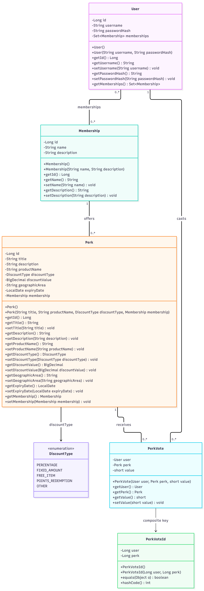

# Perk Manager

Perk Manager helps people discover, share, and organize discounts associated with memberships and cards they already have, such as Air Miles, CAA, Visa, Costco, and Scene+.

**Live Application:** https://perkmanager-bmanbbccczdtcca4.mexicocentral-01.azurewebsites.net

---

## Features

### User Accounts and Profiles
- Register an account and log in or log out.
- View personal user profiles.
- Add and remove memberships from a personal profile.
- Browse registered users and their memberships.

### Membership Browsing
- Browse available memberships and their associated perks.
- Search memberships and their perks.
- Filter perks to show offers associated with your own memberships.

### Perk Creation and Management
- Authenticated users can create and post new perks.
- Associate each perk with an existing membership.
- Specify a title, description, and applicable product or service.
- Support multiple discount types:
  - Percentage discounts
  - Fixed-amount discounts
  - Free items
  - Points redemption
  - Other discount types
- Specify optional expiry dates.
- Specify optional geographic restrictions.
- Validate submissions and display useful error messages.

### Perk Discovery
- Search perks using keywords and product or service names.
- Filter perks by membership and geographic area.
- Browse active perks.
- Sort perks by soonest expiry or highest community vote score.
- View relevant perks associated with personal memberships.

### Community Voting
- Logged-in users can upvote and downvote perks.
- Users can update or remove their existing votes.
- Perks display their accumulated community vote scores.

---

## Technology Stack

- **Backend:** Java 25, Spring Boot 4
- **Frontend:** Thymeleaf, HTML, CSS
- **Database:** PostgreSQL 17+
- **ORM:** Spring Data JPA / Hibernate
- **Database Migrations:** Flyway
- **Build Tool:** Maven
- **Deployment:** Microsoft Azure App Service
- **CI/CD:** GitHub Actions

---

# Local Development Setup

## Prerequisites

To run the application locally, you need:

- Java 25
- Maven compatible with Java 25
- PostgreSQL 17 or newer

Download PostgreSQL from the [official PostgreSQL downloads page](https://www.postgresql.org/download/).

**pgAdmin 4** is also recommended for managing your local database and troubleshooting SQL queries.

## 1. Create a Local PostgreSQL Database

Each developer should create their own local database for development and testing.

After installing PostgreSQL, open pgAdmin 4 and connect to your local PostgreSQL server.

1. Expand **Servers** in the left sidebar.
2. Expand your PostgreSQL server.
3. Right-click **Databases**.
4. Select **Create → Database**.
5. Set the database name to:

   `perkmanager`

6. Set the owner to `postgres`.
7. Click **Save**.

Flyway handles the creation and updating of database tables and initial data. You do not need to manually create the application's tables.

## 2. Configure the Database Connection

The application database connection is configured in:

`src/main/resources/application.properties`

The default configuration is:

```properties
spring.datasource.url=${DB_URL:jdbc:postgresql://localhost:5432/perkmanager}
spring.datasource.username=${DB_USERNAME:postgres}
spring.datasource.password=${DB_PASSWORD:WHATEVER_YOU_SET_YOUR_PW_TO}
```

Replace the placeholder password with the password you selected during PostgreSQL installation.

Alternatively, configure the following environment variables:

- `DB_URL`
- `DB_USERNAME`
- `DB_PASSWORD`

**Important:** Never commit personal database passwords or credentials to GitHub. Keep your local credentials private.

## 3. Run the Application

From the root project directory, run:

**Windows PowerShell:**

```powershell
mvn spring-boot:run
```

**macOS/Linux:**

```bash
mvn spring-boot:run
```

When the application starts, Flyway automatically checks and applies pending database migrations.

## 4. Access the Application

Once Spring Boot has started, open:

http://localhost:8080

The application will be available through your local browser.

---

# Building and Running the Executable JAR

Perk Manager can be packaged as an executable Spring Boot JAR. This allows the application to run without using the Maven development command.

## 1. Configure the Database

Before running the JAR, ensure that PostgreSQL is running and that the `perkmanager` database exists.

Configure the database connection using the environment variables:

- `DB_URL`
- `DB_USERNAME`
- `DB_PASSWORD`

The JAR requires access to a PostgreSQL database.

## 2. Build and Test the Application

From the project root directory, execute:

```bash
mvn clean verify
```

This command:

1. Cleans previous build artifacts.
2. Compiles the application.
3. Runs the automated tests.
4. Packages the application into an executable JAR.

## 3. Locate the Executable JAR

After a successful build, the executable JAR is generated in the `target` directory:

```text
target/perk-manager-0.0.1-SNAPSHOT.jar
```

## 4. Run the Executable JAR

Execute the following command from the project root directory:

```bash
java -jar target/perk-manager-0.0.1-SNAPSHOT.jar
```

The application will start using the configured database connection.

Flyway automatically applies any pending database migrations during startup.

## 5. Access the Application

Open the following URL in your browser:

http://localhost:8080

To stop the application, press `Ctrl+C` in the terminal running the JAR.

**Note:** The executable JAR includes the application and its runtime dependencies. PostgreSQL must still be installed and running separately.

---

### Generating the ORM Schema

Hibernate can generate a SQL representation of the database schema based on the JPA entity classes and their relationships.

To generate the ORM schema:

1. Open a PowerShell terminal in the project directory.
2. Activate the ORM export profile:

```powershell
$env:SPRING_PROFILES_ACTIVE="orm-export"
```

3. Run the application:

```powershell
mvn spring-boot:run
```

4. Hibernate generates the SQL schema at:

```text
docs/orm-schema.sql
```

The export configuration is located in `src/main/resources/application-orm-export.properties`.

This configuration generates SQL from the entity mappings without modifying the actual database.

### Returning to Normal Application Mode

After generating the schema, remove the ORM export profile from the current PowerShell session:

```powershell
Remove-Item Env:SPRING_PROFILES_ACTIVE
```

Then restart the application normally:

```powershell
mvn spring-boot:run
```

The application will return to its default configuration, where:

```properties
spring.jpa.hibernate.ddl-auto=validate
```

Hibernate validates the entity mappings against the existing database, while Flyway remains responsible for database migrations.

### Database Schema

The ORM-generated schema is maintained in `docs/orm-schema.sql`. The corresponding database schema diagram and SQL should be kept up to date whenever the entity mappings or database structure change.

The following SQL is generated from the current JPA entity mappings:

```sql
create table memberships (id bigint generated by default as identity, name varchar(100) not null unique, description TEXT, primary key (id));
create table perk_votes (vote_value smallint not null, perk_id bigint not null, user_id bigint not null, primary key (perk_id, user_id));
create table perks (discount_value numeric(10,2), expiry_date date, id bigint generated by default as identity, membership_id bigint not null, discount_type varchar(100) not null check ((discount_type in ('PERCENTAGE','FIXED_AMOUNT','FREE_ITEM','POINTS_REDEMPTION','OTHER'))), geographic_area varchar(100), product_name varchar(100) not null, title varchar(100) not null, description TEXT, primary key (id));
create table user_memberships (membership_id bigint not null, user_id bigint not null, primary key (membership_id, user_id));
create table users (id bigint generated by default as identity, username varchar(100) not null unique, password_hash varchar(255) not null, primary key (id));
alter table if exists perk_votes add constraint FK7ewripptgcsi5cvb6yp38lwt7 foreign key (perk_id) references perks;
alter table if exists perk_votes add constraint FK4ad3nn5d62s70njblsawg551y foreign key (user_id) references users;
alter table if exists perks add constraint FKinrw5rxk50hl3jb51xeyi36xd foreign key (membership_id) references memberships;
alter table if exists user_memberships add constraint FKd578eqokdbymythx3ihdde1n foreign key (membership_id) references memberships;
alter table if exists user_memberships add constraint FK3aftj3ypdb19itnsapcxykedv foreign key (user_id) references users;

```
---

# Database Migrations (Flyway)

Database schema changes are managed using **Flyway migrations**.

Migration files are located in:

```text
src/main/resources/db/migration/
```

Migration filenames must follow this convention:

```text
V1__create_perks_and_memberships.sql
V2__insert_initial_data.sql
V3__add_perk_category.sql
```

Generally, the naming format is:

```text
Vn__description.sql
```

### Creating a New Migration

When database changes are required:

1. Create a new migration file using the next available version number.
2. Write the SQL statements for the required changes.
3. Commit the migration file to GitHub.
4. When other developers pull the changes and run the application, Flyway automatically applies the new migration to their local databases.

**Important:** Never modify migration files that have already been applied to a database. Always create a new migration for additional database changes.

Modifying an applied migration can cause Flyway validation errors and prevent the application from starting.

---

# Database Schema and ORM Generation

The database schema is managed using Flyway migrations, while Hibernate uses the JPA entity mappings to represent the application's database structure.

### Generating the ORM Schema

Hibernate can generate a SQL representation of the database schema based on the JPA entity classes and their relationships.

To generate the ORM schema:

1. Open a PowerShell terminal in the project directory.
2. Activate the ORM export profile:

```powershell
$env:SPRING_PROFILES_ACTIVE="orm-export"
```

3. Run the application:

```powershell
mvn spring-boot:run
```

4. Hibernate generates the SQL schema at:

```text
docs/orm-schema.sql
```

The export configuration is located in:

`src/main/resources/application-orm-export.properties`

This configuration generates SQL from the entity mappings without modifying the actual database.

### Returning to Normal Application Mode

After generating the schema, remove the ORM export profile from the current PowerShell session:

```powershell
Remove-Item Env:SPRING_PROFILES_ACTIVE
```

Then restart the application normally:

```powershell
mvn spring-boot:run
```

The default configuration uses:

```properties
spring.jpa.hibernate.ddl-auto=validate
```

Hibernate validates the entity mappings against the existing database, while Flyway remains responsible for database migrations.

### Database Schema Files

The ORM-generated schema is maintained in:

`docs/orm-schema.sql`

The corresponding database schema diagram and SQL should be kept up to date whenever the entity mappings or database structure change.

---

# UML Class Diagram

The following diagram illustrates the application's main classes, entities, and relationships.



---

# Deployment

Perk Manager is deployed using **Microsoft Azure App Service** with an Azure Database for PostgreSQL Flexible Server.

**Live Application:** https://perkmanager-bmanbbccczdtcca4.mexicocentral-01.azurewebsites.net

### Continuous Integration and Deployment

The project uses GitHub Actions for automated building, testing, and deployment.

- Every push to `main` triggers the `main_perkmanager.yml` workflow.
- The deployment workflow builds the executable JAR and deploys it to Azure App Service.
- The Maven CI workflow runs automated tests against a PostgreSQL 17 database.
- Pull requests targeting `main` also trigger the Maven CI workflow.

### Environment Configuration

The deployed application reads its database settings from environment variables:

- `DB_URL`
- `DB_USERNAME`
- `DB_PASSWORD`

These variables are configured in Azure App Service settings and are never committed to the repository.

### Database Migrations in Production

Flyway also runs automatically when the application starts in Azure.

Database migrations must be versioned correctly. Never edit migrations that have already been applied to the production database. Create a new migration for any subsequent schema changes.

---

# Project Structure

```text
perk-manager/
│
├── docs/
│   ├── ModelsClassUML.png
│   └── orm-schema.sql
│
├── src/
│   ├── main/
│   │   ├── java/
│   │   │   └── com/perkmanager/perk_manager/
│   │   │       ├── controller/
│   │   │       ├── model/
│   │   │       ├── repository/
│   │   │       └── services/
│   │   │
│   │   └── resources/
│   │       ├── db/migration/
│   │       ├── templates/
│   │       ├── static/
│   │       ├── application.properties
│   │       └── application-orm-export.properties
│   │
│   └── test/
│       └── java/
│
├── .github/
│   └── workflows/
│
├── pom.xml
└── README.md
```

---

## Contributing

1. Create a feature branch from the latest `main`.
2. Implement your changes.
3. Run the automated tests before submitting your changes.
4. Commit and push your feature branch.
5. Open a Pull Request targeting `main`.

All database schema changes must include the appropriate Flyway migration files.